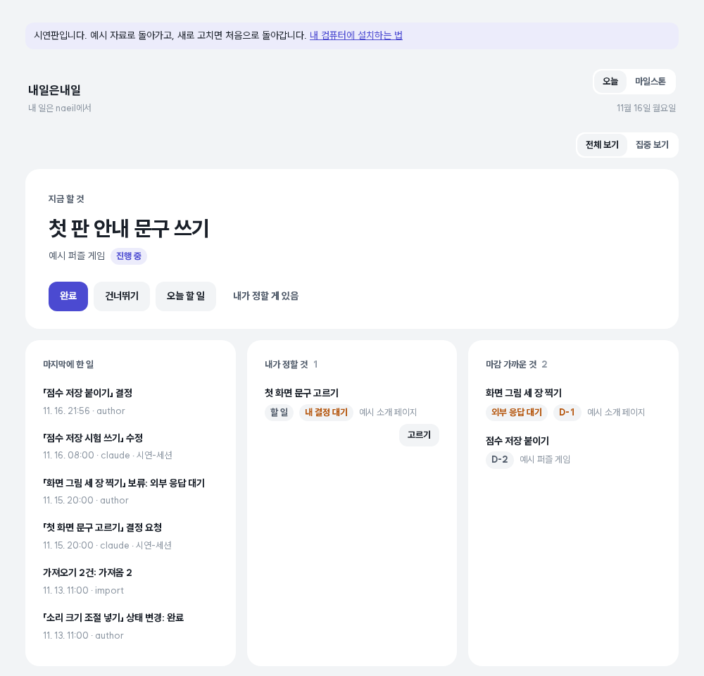

# 내일은내일 (naeil)

> **내 일은 naeil에서**
> AI 세션을 여러 개 오가도 어제 한 일을 잃지 않는 1인 개발자 작업판  
> AI로 지시해서 끝내고, 실제 문제는 없는지 직접 검증한다

**바로 눌러 보기:** [공개 시연판](https://naeil-demo.pages.dev) (예시 자료, 새로 고치면 처음으로. 설치 없이 브라우저 안에서 돎. 첫 올리기 전이면 아직 안 열림, `docs/ops/demo.md`)

| PC | 폰 |
|---|---|
|  |  |

## 되는 것 (0.2.0)
- **오늘 화면**: 지금 할 것 1개, 마지막에 한 일, 내가 정할 것, 마감 가까운 것. 지금 할 것은 서버가 계산해서 PC, 폰, AI 도구가 같은 것을 봄. 건너뛰기와 「오늘 할 일」 고정도 날짜별로 서버에
- **마일스톤 화면**: 프로젝트마다 진행 막대, 다음 마일스톤 강조, 마일스톤마다 「끝나면」 한 줄
- **결정 대기함**: AI 세션이 질문, 선택지, 추천, 근거를 남기면 할 일이 「내 결정 대기」로 멈춤. 버튼 하나로 고르면 풀리고, 세션은 고른 답을 읽어 감
- **인수인계 문서**: 목표, 남은 일과 어디까지, 바뀐 것, 근거, 막힌 것을 한 번에 복사. 다음 세션에 붙여 넣으면 이어서 시작
- **가져오기**: vault 할 일 목록 파일과 깃허브 이슈를 한 시간마다. 출처에서 바뀐 칸만 고치고, 작업판에서 끝낸 일을 되돌리지 않음. 깃허브 이슈는 AI 담당
- **API 키 종류**: 사람, AI 세션, CI. 변경 기록마다 누가, 어떤 종류로 바꿨는지
- **사용 기록**: 날마다 처음 연 시각, 내가 바꾼 수, 고른 결정 수, AI 가 바꾼 수, 가져오기 수
- **휴지통**: 할 일, 마일스톤, 프로젝트. 프로젝트는 안의 것까지 같이 넣고 같이 되돌림
- **늘 켜 두기**: 윈도우 데스크톱에서 컴퓨터가 켜지면 로그인 전에도 켜지고, 죽으면 다시 켜지고, 매일 백업과 복원 연습. 폰은 Tailscale 암호화 주소로

## 안 되는 것 (지금 한계)
- 혼자 쓰는 구조. 작업공간은 하나, 화면용 API 키도 하나
- AI 세션 권한 구분이 아직 없음. AI용 API 키도 사람과 거의 같은 동작을 할 수 있음 (프로젝트 휴지통 포함, M2 에서 막음)
- AI 도구 연결(MCP)은 아직. 세션은 HTTP API 나 vault 요청함으로 요청
- 백업은 같은 컴퓨터 안에만. 집 밖 사본은 아직 (M4)
- 운영 이슈와 수정 검증 연결은 아직 (M3)
- 맥 앱 없음. 브라우저로 씀
- 시연판은 저장하지 않음. 새로 고치면 지워짐

## 증거
| 무엇 | 어디서 | 결과 |
|---|---|---|
| 서버와 저장소 시험 | `npm test`, CI | 236개 통과. 모든 응답을 명세서와 대조, 묶음 저장 실패 주입 포함 |
| 실제 브라우저로 누르기 | `npm run e2e`, CI | 112건 통과. 캡처는 CI 결과물 |
| 빌드 스모크 테스트 | `npm run smoke` | 14건 통과. 저장소 밖 빈 폴더에서 켜고 백업까지 |
| 윈도우 상시 서버 | CI `windows` (실제 윈도우) | 배포, 죽였다 다시 켜기, 매일 백업, 다시 배포, 되돌리기, 해제 |
| 공개 시연판 | `npm run e2e:demo`, CI `demo` | 16건 통과. PC 폭, 폰 폭, 외부 요청 없음 |
| 실제 윈도우 배포 | 작가 데스크톱 | 0.1.1 배포와 가져오기 8/8, 할 일 23개, 다시 가져와도 새로 0 (2026-11-16) |
| 실제로 써 본 날 | 사용 기록(`GET /v1/usage`) | 이번 버전부터 셈 |

## 만드는 순서
M0, M1 은 마일스톤(계획 묶음) 번호이고, 0.1.0 같은 버전 번호와 따로 감. 기능이 들어가면 가운데 자리, 고침만 있으면 끝 자리가 오름 (`CHANGELOG.md` 맨 위). 화면과 문서에 쓰는 말은 [용어집](docs/glossary.md).

| 마일스톤 | 끝나면 | 상태 |
|---|---|---|
| M0 바닥 정리 | 윈도우에서 늘 켜져 있고(폰에서도 열림), 자료를 잃어도 되살릴 수 있고, 공개 저장소에 강점이 보임 | 끝 |
| M1 실제로 쓰기 | 하루를 여기서 시작하고, 쓴 기록이 날짜별로 남음 | 끝 (0.1.0) |
| M2 AI 경계 | AI 세션이 작업을 보고 바꾸되 허용된 만큼만 (권한표, 세션 잡기와 놓기, MCP 연결) | 다음 버전 |
| M3 게임 운영 연결 | 작업에서 원본 운영 이슈와 수정 검증 결과까지 봄 | 다음 버전 |
| M4 나중 | 집 밖 백업, 조직마다 맞춰 바꾸기, 앱과 배포(직접 써서 필요가 확인되면 폰 앱을 만들고 지인에게 먼저 배포. 맥 앱은 타우리 또는 Claude 「앱으로 설치」 중 고름), 스킬 상점 | 다음 버전 |

## 더 보기
- [어떻게 만들었나](docs/how-it-was-built.md): 작가가 정하고, 클라우드 Claude 가 만들고, 작가 컴퓨터의 Codex 가 확인하는 한 바퀴와 실제 예
- [비슷한 도구와 비교](docs/research/similar-tools.md): Backlog.md, agents-board, agendum, handover 와 겹치는 것, 남는 자리

## 처음 한 번
```bash
cd naeil
npm ci
cp .env.example .env          # 포트 등. 자료 파일 자리는 비워 두면 저장소 밖 앱 자료 폴더
npm run key -- new author     # 화면용 API 키. 한 번만 보이니 바로 복사
```

## 켜기
```bash
npm start                     # 서버와 화면을 빌드하고, 빌드한 버전으로 켠다 → http://127.0.0.1:3700
```
늘 켜 두려면 윈도우는 `npm run deploy:windows`, 맥은 `npm run deploy:mac`. 폰에서는 `scripts\windows\phone.ps1` 이 여는 Tailscale 암호화 주소로. 자세한 것은 `docs/ops/running.md`.

처음 열면 API 키 칸이 나온다. 위에서 복사한 `nk_…` 를 붙여 넣는다.

## API 키 (도구마다 1장)
| 명령 | 하는 일 |
|---|---|
| `npm run key -- new author` | 화면용 (사람) |
| `npm run key -- new claude` | Claude 세션용 (AI) |
| `npm run key -- new codex` | Codex 세션용 (AI) |
| `npm run key -- new <이름> --kind <human, ai, ci>` | 그 밖의 이름은 종류를 밝힘 |
| `npm run key -- revoke <이름>` | 폐기. 자료 파일 밖 폐기 키 목록에도 적혀, 백업에서 복원해도 막힌 채로 |
| `npm run key -- list` | 목록 (키 원문은 다시 못 봄) |

- 서버에는 키 원문 대신 잠근 값(해시)만 남는다
- AI 세션은 요청 머리말에 `Authorization: Bearer <키>` 와 세션 이름표 `X-Naeil-Session: session-3` 를 붙인다
- 「누가 바꿨나」는 서버가 API 키를 보고 정한다

## API 한눈에
전체는 `docs/api/openapi.yaml`. 오류는 전부 한 가지 모양(`application/problem+json`), 종류는 `docs/errors.md`.

| 주소 | 하는 일 |
|---|---|
| `GET /health` | 살아 있고 자료가 읽히나 (API 키 없이). 최근 백업과 복원 연습 결과도 |
| `/v1/projects`, `/v1/projects/{id}`, `/v1/projects/{id}/revive` | 프로젝트 목록, 만들기, 이름 변경, 휴지통, 되돌리기 |
| `/v1/projects/{id}/milestones`, `/v1/milestones/{id}` | 마일스톤 목록, 만들기, 이름과 마감과 「끝나면」 변경, 휴지통 |
| `/v1/tasks`, `/v1/tasks/{id}` | 할 일 목록(거르기, 커서), 만들기(`Idempotency-Key`), 고치기(`If-Match`), 휴지통 |
| `/v1/tasks/{id}/block`, `/v1/tasks/{id}/revive` | 보류 걸기와 풀기, 되돌리기 |
| `/v1/tasks/{id}/decision`, `/v1/decisions` | 결정 대기함: 묻기, 답하기, 목록 |
| `/v1/today` | 오늘: 지금 할 것, 내가 정할 것, 마감 가까운 것. 고정과 건너뛰기 |
| `/v1/handoff` | 인수인계 문서 |
| `/v1/changes` | 변경 기록 (누가, 종류, 항목, 날짜로 거르기) |
| `/v1/usage` | 날짜별 사용 기록 |
| `/v1/settings` | 기능 기능 설정. AI 가 끄면 이유 한 줄 필수, 오늘 화면 맨 위에 알림 |

## 만들 때
```bash
npm run dev          # 서버 (코드 바꾸면 다시 켜짐)
npm run dev:web      # 화면 (http://127.0.0.1:5173, API는 3700으로 넘김)
npm run check        # 코드 검사, 타입 검사, 시험, 빌드 스모크 테스트
npm run e2e          # 빌드하고 실제 브라우저로 흐름 전부 (캡처는 test/e2e/out/)
npm run e2e:demo     # 시연판 빌드하고 시험
npm run lint:api     # 명세서 검사
```
- 서버 입력 검사는 명세서에서 그대로 읽는다. 규칙을 코드에 두 번 적지 않는다
- 시험이 모든 응답을 명세서와 대조한다 (번호, 내용 종류, 본문 모양, 약속한 머리말)
- 표 구조 변경은 `migrations/` 에 올리기와 되돌리기 파일로
- 바뀐 내용은 `CHANGELOG.md`

## 지키는 것
- 비밀 키는 저장소에 올리지 않는다 (`.env` 는 올라가지 않음, 올리기 검사 있음)
- 실제 할 일 데이터는 저장소에 넣지 않는다. 예시 데이터만
- 서버는 기본으로 이 컴퓨터 안에서만 열린다. 폰은 Tailscale 안에서만

## 라이선스
MIT
